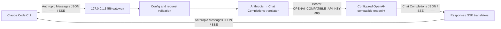

# OpenAI-Compatible Claude Code Gateway

A standalone, dependency-free Node.js gateway that accepts the Anthropic Messages API used by Claude Code and translates it to a configured OpenAI-compatible `POST /v1/chat/completions` endpoint. It is a separate service; it does not patch Claude Code's compiled CLI or add an in-process provider driver.

The gateway is intended for any conforming Chat Completions endpoint configured without source edits: a hosted provider, private hosted gateway, local Ollama/vLLM/LM Studio service, or a compatible reverse proxy. **Provider compatibility is capability-dependent**. A working `/chat/completions` text request does not prove tools, vision, structured output, or all sampling parameters work on that model.

## Architecture



## Prerequisites and install

- Node.js 20 or newer (the implementation and tests use built-in Node modules only).
- A configured OpenAI-compatible Chat Completions endpoint and the upstream model ID. Provider/API charges may apply.
- Claude Code CLI installed separately and available as `claude`, or provide `CLAUDE_BIN` with its executable path.

From a fresh checkout of this repository, open PowerShell in the gateway directory:

```powershell
cd tools/openai-compatible-claude-gateway
Copy-Item .env.example .env
notepad .env
npm run check
npm test
npm start
```

The server runs in the foreground. Start it in one terminal and keep it running. It does not spawn background copies or terminate another process. If port `3456` is occupied, startup reports the conflict; change `GATEWAY_PORT` in `.env` or deliberately stop the other process yourself.

In a second PowerShell terminal, from the same gateway directory, launch Claude Code through the wrapper:

```powershell
.\scripts\start-claude-with-openai-provider.ps1
# With a prompt in print/noninteractive mode:
.\scripts\start-claude-with-openai-provider.ps1 -p "Say hello in one sentence."
```

The wrapper checks `/health`, configures only the child Claude Code environment, and returns Claude Code's exit status. It does not edit shell profiles, persist environment variables, write Claude settings, or change `.env`. The wrapper reads `GATEWAY_PORT`, `GATEWAY_HOST`, and `GATEWAY_API_KEY` from process environment first, then the gateway `.env` file when those values are not set. For compatibility with this schema-translating gateway it also sets `CLAUDE_CODE_ATTRIBUTION_HEADER=0` (the bridge reshapes system content), `CLAUDE_CODE_DISABLE_THINKING=1` (Anthropic thinking blocks have no generic mapping), and by default `CLAUDE_CODE_DISABLE_EXPERIMENTAL_BETAS=1` (unless you set that variable yourself before launching). It sets `CLAUDE_CODE_EFFORT_LEVEL=auto` only when you have not set an effort level. This avoids sending unsupported Anthropic-only body fields by default; it does not disable the Auto Mode classifier or normal permission checks. Setting `CLAUDE_CODE_DISABLE_EXPERIMENTAL_BETAS=0` opts beta features back in, but only do so for capabilities that the gateway has an explicit mapping for. To test configured OpenAI reasoning effort, set `CLAUDE_CODE_EFFORT_LEVEL=low`, `medium`, or `high` and configure `reasoningEffort=true` for the upstream model.

POSIX shell equivalent:

```sh
cd tools/openai-compatible-claude-gateway
cp .env.example .env
# Edit .env with a text editor; do not check credentials into git.
npm run check
npm test
npm start
# In a second terminal:
./scripts/start-claude-with-openai-provider.sh -p 'Say hello in one sentence.'
```

The launcher requires `curl` for its health check. Override the CLI executable with `CLAUDE_BIN` if needed. To override the gateway root URL for the wrapper, set `GATEWAY_BASE_URL` in that wrapper's environment. That URL must point to this gateway, not to the upstream provider.

## Configure one provider

Edit `.env` in this directory. For a local server, a typical configuration is:

```dotenv
OPENAI_COMPATIBLE_BASE_URL=http://127.0.0.1:8000/v1
OPENAI_COMPATIBLE_API_KEY=
OPENAI_COMPATIBLE_MODEL=your-local-model-id
OPENAI_COMPATIBLE_MODEL_MAP={"claude-sonnet":"your-local-model-id"}
OPENAI_COMPATIBLE_MODEL_CAPABILITIES={"your-local-model-id":{"toolCalling":true},"claude-sonnet":{"images":false}}
OPENAI_COMPATIBLE_CAPABILITIES={"streaming":true,"toolCalling":true,"parallelToolCalls":false,"images":false,"jsonSchema":false,"reasoningEffort":false,"temperature":true,"topP":true,"stopSequences":true,"streamUsage":true,"streamRequiresDone":true,"maxTokensField":"max_tokens"}
GATEWAY_HOST=127.0.0.1
GATEWAY_PORT=3456
GATEWAY_API_KEY=replace-with-a-long-random-local-token
```

For a hosted endpoint, use HTTPS and its configured bearer key:

```dotenv
OPENAI_COMPATIBLE_BASE_URL=https://provider.example/custom/openai/v1
OPENAI_COMPATIBLE_API_KEY=replace-with-your-provider-key
OPENAI_COMPATIBLE_MODEL=provider-model-id
OPENAI_COMPATIBLE_MODEL_MAP={"claude-sonnet":"provider-model-id"}
```

Do not paste actual secrets into tickets, chat transcripts, source control, test fixtures, or logs. `.env` and `gateway.config.json` are ignored by this package's local `.gitignore`; `.env.example` contains placeholders only. The service parses `.env` itself and does not mutate `process.env` or your caller's shell. Existing process environment variables take precedence over `.env` values. `GATEWAY_ENV_FILE` can select a different file path. No variable expansion or shell evaluation is performed in `.env` values.

### Model routing

Routing order is exact requested-model entry in `OPENAI_COMPATIBLE_MODEL_MAP`, then `OPENAI_COMPATIBLE_MODEL`, then requested-model pass-through only when `OPENAI_COMPATIBLE_MODEL_PASSTHROUGH=true`. If no route is available, the request fails clearly; the gateway never changes models mid-turn. The client-facing Anthropic `model` remains the requested Claude model/alias so Claude Code sees a stable protocol identifier. The configured upstream model is used only on the upstream request.

### Per-model capability configuration

OPENAI_COMPATIBLE_CAPABILITIES supplies the conservative baseline. OPENAI_COMPATIBLE_MODEL_CAPABILITIES optionally maps requested/client model IDs or resolved upstream model IDs to partial overrides. Resolution order is global baseline, upstream-model override, then exact requested-alias override; the requested alias wins when both declare the same field. Unknown fields, invalid values, and resolved combinations with parallelToolCalls=true but toolCalling=false fail during config validation. Only enable capabilities you have actually validated for that model.

Model IDs in `/v1/models` are derived from configured aliases and the default upstream model. The gateway does not query upstream `/models` at startup and therefore does not fail when that optional endpoint is unavailable. Claude Code's model-picker discovery is opt-in; where supported, set `CLAUDE_CODE_ENABLE_GATEWAY_MODEL_DISCOVERY=1` in the child environment to populate it.

### Endpoint path normalization

| Configured `OPENAI_COMPATIBLE_BASE_URL` | Resulting Chat Completions path |
|---|---|
| `https://provider.example` | `/v1/chat/completions` |
| `https://provider.example/v1` | `/v1/chat/completions` |
| `https://provider.example/custom/openai/v1` | `/custom/openai/v1/chat/completions` |
| `https://provider.example/custom/v1/chat/completions` | unchanged |
| Any base URL plus `OPENAI_COMPATIBLE_CHAT_COMPLETIONS_PATH=/openai/v1/chat/completions` | explicit path replaces the base URL pathname |

A URL query string is preserved for the upstream request and the derived `/models` URL, but is never written to gateway logs. Embedded URL username/password credentials and URL fragments are rejected. HTTPS is required for non-loopback upstreams unless `OPENAI_COMPATIBLE_ALLOW_INSECURE_HTTP=true` is explicitly set. That opt-in accepts cleartext transport and should only be used on a trusted network. The explicit path override must be an absolute URL pathname ending in `/chat/completions`.

## API and protocol behavior

| Gateway route | Behavior |
|---|---|
| `POST /v1/messages` | Required; translates Anthropic request and returns Anthropic JSON or Anthropic SSE events. |
| `GET /v1/models` | Returns configured aliases/default model IDs in Anthropic model-list shape. |
| `GET /health` | Unauthenticated status only: `{"status":"ok"}`. Does not include secrets/configuration. |
| `GET /` | Safe service status and route names only. |
| `HEAD /api/hello` | `204` connection-warming response. |
| `POST /v1/messages/count_tokens` | `404 not_found_error`; exact token counting is not available from generic Chat Completions. Current Claude Code gateway documentation says it falls back to a character-based estimate when the optional endpoint is absent. |

The inbound adapter recognizes and translates top-level system text and system-role entries within a message list (a compatibility form emitted by Claude Code's custom-base-URL path), ordered user/assistant turns, text and configured image blocks, tool definitions/choices, tool-call results, sampling parameters, stop sequences, JSON schema output when configured, and supported usage/finish reasons. It rejects unknown top-level fields and unsupported Anthropic block kinds rather than silently pretending the feature worked. `metadata` is consumed locally (it is not sent upstream). Anthropic cache-control annotations are consumed because generic Chat Completions has no interoperable prompt-cache protocol; caching benefits are not promised.

Generic Chat Completions cannot be assumed to preserve Anthropic extended thinking, server-side tools, arbitrary document/audio/video blocks, MCP server configuration, context-management features, or Anthropic's safety-classifier protocol. Unsupported required behavior returns an Anthropic-shaped error. The gateway does not execute tools; Claude Code remains the tool executor.

### Capability matrix

| Capability | Gateway behavior | Required operator action |
|---|---|---|
| Text, basic messages, model mapping | Implemented and locally integration-tested | Configure endpoint/model. |
| Non-streaming JSON responses | Implemented and locally integration-tested | Endpoint must return Chat Completions-shaped JSON. |
| Streaming SSE | Incremental parser/translator; no full-response buffering | Keep `streaming=true` only for providers validated with SSE; `streamRequiresDone=true` requires `[DONE]` and a final finish reason. |
| Function tools and multi-turn results | Implemented, including fragmented streamed arguments and exact tool-call IDs | Set `toolCalling=true` only after validating tool calls on the chosen provider/model. |
| Parallel function calls | Preserves multiple IDs/order; tells upstream not to parallelize when disabled by request | Set `parallelToolCalls=true` only after validation; the request still declares the configured tool set. |
| Vision/images | Supports base64/data URLs and credential-free HTTP(S) image URLs | Set `images=true` only after validating model and endpoint support, including image-bearing tool results. |
| Structured JSON Schema | Maps Anthropic `output_config.format` to Chat Completions `response_format.json_schema` | Set `jsonSchema=true` only after validating the exact schema dialect/strict behavior. |
| Reasoning metadata / effort | Maps only explicit `low`, `medium`, `high` effort to `reasoning_effort` | Set `reasoningEffort=true` only after validating that provider-specific mapping. Anthropic extended thinking is rejected. |
| `max_tokens` vs `max_completion_tokens` | Configurable via `OPENAI_COMPATIBLE_MAX_TOKENS_FIELD` or `capabilities.maxTokensField` | Choose the field supported by the configured API/model. |
| Temperature, top-p, stop sequences | Translated only if corresponding capability flag is enabled | Validate constraints for the provider/model. |
| Exact token count | Not implemented; no fabricated token totals | Claude Code should use its documented estimate fallback. |
| Anthropic server-side Auto Mode classifier | **Not supported by generic Chat Completions.** No safety verdicts are fabricated. | Use the supported launcher to select the local classifier path. Do not opt into server checks without independently proven upstream support. |
| Provider-specific extensions, audio/video, MCP/server tools, extended thinking | Rejected when they appear as unsupported request fields/content | Use a provider-specific adapter only after a correct protocol mapping is designed and tested. |

When upstream usage is missing, required Anthropic numeric usage fields are emitted as `0` as an **unknown/unreported sentinel**, not as a measurement. Check provider-side usage/billing for authoritative counts. The adapter does not calculate fake exact token counts. `cache_control` cache hints do not have a generic Chat Completions equivalent; the bridge treats them as provider-irrelevant optimization hints and does not claim prompt-cache billing or cache-hit semantics.

## Auto Mode classifier, warning, and billing truth

Anthropic's current gateway and Auto Mode guidance describes the server classifier protocol as a `safeguards` request field paired with `safeguard_results` response data. A generic OpenAI Chat Completions endpoint is not assumed to support it. This gateway rejects `safeguards` as an unsupported field and will not synthesize `safeguard_results` or claim to be eligible for Anthropic's no-charge server-side classifier.

Both provided launchers set `CLAUDE_CODE_AUTO_MODE_SERVER=0` **in the child Claude Code process**. That selects Claude Code's own classifier path and prevents the specific server-classifier eligibility notice on supported Claude Code versions. It does **not** make classifier requests free: the active model/provider's ordinary usage or credit billing may apply. Auto Mode safety checks are not disabled by this variable; the classifier runs client-side instead. The launcher does not set `CLAUDE_CODE_DISABLE_NONESSENTIAL_TRAFFIC`, bypass permissions, or turn off other safety checks.

If Claude Code is launched manually without the wrapper, set the variable before starting it:

```powershell
$env:ANTHROPIC_BASE_URL = 'http://127.0.0.1:3456'
$env:CLAUDE_CODE_AUTO_MODE_SERVER = '0'
# Only when local gateway auth is configured:
$env:ANTHROPIC_AUTH_TOKEN = $env:GATEWAY_API_KEY
claude
```

```sh
export ANTHROPIC_BASE_URL=http://127.0.0.1:3456
export CLAUDE_CODE_AUTO_MODE_SERVER=0
# Only when local gateway auth is configured:
export ANTHROPIC_AUTH_TOKEN="$GATEWAY_API_KEY"
claude
```

The manual commands above change only the current shell session, but the wrapper is preferred because it also isolates upstream credentials. Do not set server-side classifier checks to `1` or otherwise attempt to opt into the feature unless the configured upstream has independently demonstrated the actual safeguards protocol and exact response semantics. No such mode is implemented here.

## Security and operations

- Default listener is `127.0.0.1:3456`. A non-loopback bind requires both `GATEWAY_ALLOW_REMOTE=true` and a non-empty `GATEWAY_API_KEY`.
- `GATEWAY_API_KEY` authenticates Claude Code to the local gateway; `OPENAI_COMPATIBLE_API_KEY` authenticates this gateway to the provider. The latter is never forwarded to Claude Code. Upstream requests are constructed with fresh headers and use only the configured upstream key as `Authorization: Bearer …`.
- If local auth is enabled, the gateway accepts a bearer `Authorization` token or `x-api-key` and compares using a constant-time comparison over fixed-length digests. `/health` does not reveal secret/configuration values and remains available without auth.
- No request/response bodies, prompt text, code, request headers, tokens, or upstream error payloads are logged by default. Logs use a correlation ID and status/error code. Provider error bodies are not copied into client-facing error messages.
- CORS is denied by default; no `Access-Control-Allow-Origin` is emitted. Incoming request bodies and concurrent requests are bounded.
- `GATEWAY_REQUEST_TIMEOUT_MS`, `GATEWAY_STREAM_IDLE_TIMEOUT_MS`, `GATEWAY_MAX_BODY_BYTES`, `GATEWAY_MAX_OUTPUT_TOKENS`, and `GATEWAY_MAX_CONCURRENT_REQUESTS` are configurable. The default output-token ceiling is 1,000,000; lower it to suit your deployment and upstream capacity. Requests over the configured ceiling are rejected before any provider request is sent.
- Client disconnects abort upstream fetches; shutdown cancels active upstream requests. No inference retry is performed because retrying after a potentially billed request or partial stream can duplicate work.
- Port conflicts fail without killing another process. The server is foreground-only; start it once and stop it with Ctrl+C.

## Real CLI smoke test

`npm run cli-smoke` exercises an installed Claude Code CLI against a gateway instance connected only to a deterministic fake OpenAI-compatible server. It does not need a Claude account, a real provider endpoint, or provider credentials. The script uses the CLI executable on `PATH` (or `CLAUDE_BIN`), sends one non-interactive prompt, and verifies that the fake upstream received the request without receiving local gateway authentication. The hosted Linux CI installs Claude Code using Anthropic's native installer with auto-updates disabled for the test, then runs this smoke check. This is separate from the gateway-only test suite.


## Validation commands

```sh
npm run check
npm test
npm run smoke
npm pack --dry-run
```

`npm run check` syntax-checks all `.js`/`.mjs` runtime, script and test files. Repository CI also installs the generated npm tarball into an isolated temporary prefix and repeats the checks and tests from the installed package. There is intentionally no external linter/type-checker or compilation step: the implementation is dependency-free JavaScript, not TypeScript. `npm test` exercises config, request/response conversion, SSE chunking, credential separation, authentication, the HTTP integration path, and multi-turn tool use against a deterministic local fake upstream. `npm run smoke` runs the real HTTP integration subset. None of these commands contacts a hosted provider or makes billable model calls.

The local development machine may not have Claude Code installed; the hosted Linux CI installs the current CLI and performs the real-CLI smoke test against the deterministic fake upstream. The Windows CI job runs the PowerShell wrapper end to end with a fake health server and fake CLI. Neither test sends a request to a billable model provider.

## Troubleshooting

- **`OPENAI_COMPATIBLE_BASE_URL is required`**: copy `.env.example` to `.env` and configure the upstream base URL.
- **Bad endpoint / 404**: inspect endpoint composition in startup output. If the provider uses a custom endpoint, set `OPENAI_COMPATIBLE_CHAT_COMPLETIONS_PATH` to its full absolute path ending in `/chat/completions`. Ensure that the provider serves the Chat Completions contract rather than only an unrelated API.
- **HTTP 401/403 from upstream**: verify `OPENAI_COMPATIBLE_API_KEY`, the provider's bearer-token contract, model access, and account permissions. Do not copy the upstream key into `ANTHROPIC_API_KEY`.
- **Unknown model**: set `OPENAI_COMPATIBLE_MODEL` or an exact entry in `OPENAI_COMPATIBLE_MODEL_MAP`.
- **Tool/image/JSON schema unsupported**: leave that capability disabled or enable it only after an endpoint/model-specific test. An OpenAI-compatible URL alone is not proof of tool or vision support.
- **SSE JSON, finish reason, or `[DONE]` errors**: verify `Content-Type: text/event-stream`, valid JSON event frames, final finish reason and `[DONE]` behavior. If the provider deliberately omits `[DONE]`, set `streamRequiresDone=false` only after validating complete stream termination against that provider.
- **Local port conflict**: set a different `GATEWAY_PORT` in `.env`, restart the gateway, and launch through the wrapper using the same configured port.
- **Auto Mode notice**: ensure Claude Code was launched through the wrapper or that `CLAUDE_CODE_AUTO_MODE_SERVER=0` is set in the CLI process. The fallback classifier may still be billed by the selected provider.
- **Connection lost / stalled output**: reduce network stalls or configure `GATEWAY_STREAM_IDLE_TIMEOUT_MS` and `GATEWAY_REQUEST_TIMEOUT_MS` to suit the provider. A provider that disconnects mid-stream cannot be repaired by synthesizing a completed answer.

## Official compatibility references checked

Checked 29 October 2026:

- [Claude Code gateway compatibility guide](https://code.claude.com/docs/en/llm-gateway-protocol) — Messages endpoints, startup probe, streaming event order, header/body pass-through, model discovery, and gateway feature behavior.
- [Auto Mode configuration](https://code.claude.com/docs/en/auto-mode-config) — eligibility and classifier behavior. [Environment variables](https://code.claude.com/docs/en/env-vars) — `CLAUDE_CODE_AUTO_MODE_SERVER`, attribution headers, thinking, beta, and effort compatibility settings.
- [Claude Code environment variables](https://code.claude.com/docs/en/env-vars) — `ANTHROPIC_BASE_URL`, child environment configuration, and variable behavior.

This adapter implements an independently developed protocol translation layer. It is not an official Anthropic gateway and does not modify Claude Code's closed runtime. Use of the surrounding repository remains subject to its own license terms.
